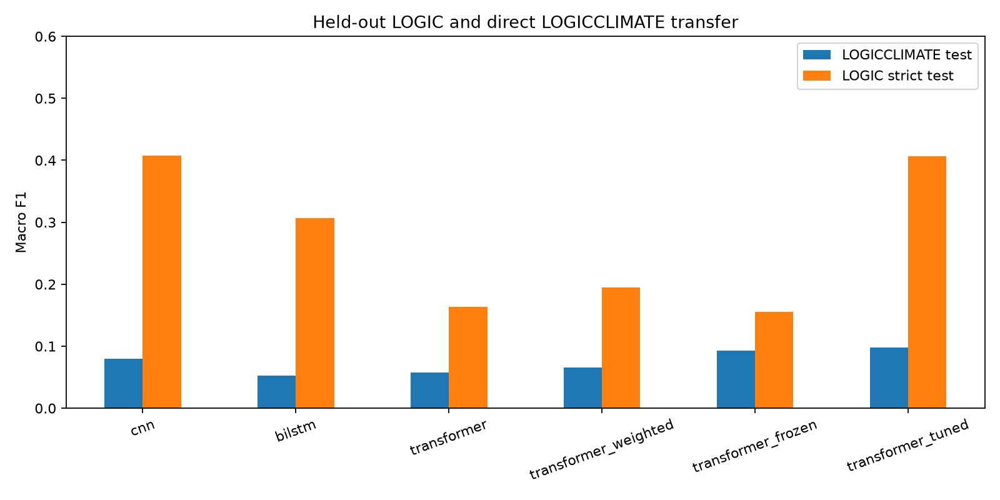

# FallacyLens: CNN, BiLSTM, and compact Transformer comparison

**Final B.Tech deep learning project report, Phases 1–3**

**Experiment date:** 22 October 2026
**Task:** classify textual arguments into the 13 released LOGIC fallacy labels.

## Abstract

FallacyLens studies whether model architecture and pretrained contextual representations help on a small, imbalanced fallacy dataset. Phase 1 established the literature review, dataset audit, and initial CNN baseline; its [report](PHASE1_REPORT.md) remains the source for the full ten-paper review. The final experiment retrains a CNN and a BiLSTM under one data protocol and compares them with a compact pretrained BERT model. It also measures class weighting, freezing the pretrained encoder, direct transfer to climate claims, class-level errors, and local token-deletion sensitivity. All scores below are produced by the executable pipeline and saved predictions, with no manually invented outcomes.

## 1. Research questions

1. Under identical training examples and label definitions, how do a CNN, BiLSTM, and pretrained Transformer compare on held-out LOGIC examples?
2. Does class weighting improve macro F1 for the Transformer, particularly on rare classes?
3. How much does freezing the pretrained encoder change performance?
4. How well do models trained only on LOGIC transfer directly to LOGICCLIMATE?
5. Which labels and examples remain difficult, and which input tokens most affect one selected model's output?

The comparison is a practical architecture study, not a claim that model size, tokenization, pretraining, and architecture have been independently isolated. The CNN and BiLSTM learn word embeddings from LOGIC; the BERT model starts with pretrained weights and uses its own subword tokenizer.

## 2. Sources and dataset

The primary dataset and climate challenge set come from Jin et al., [*Logical Fallacy Detection*](https://aclanthology.org/2022.findings-emnlp.532/) (Findings of EMNLP 2022) and the [authors' repository](https://github.com/causalNLP/logical-fallacy). The data loader pins repository commit `2a3d09708122c0994279df034d867b80950700ea` and checks exact CSV hashes. The pretrained encoder is [prajjwal1/bert-tiny](https://huggingface.co/prajjwal1/bert-tiny), a small BERT variant intended for downstream fine tuning; its repository revision is pinned to `6f75de8b60a9f8a2fdf7b69cbd86d9e64bcb3837`. These links were reopened for this phase. The exact downloaded CSV hashes are in `results/final/protocol.json`.

LOGIC has 1,849 / 300 / 300 released train / dev / test rows. The released rows each carry one class label; the source paper discusses a broader multi-label framing. LOGICCLIMATE uses the same fallacy taxonomy but climate-news text. We use only its released test CSV for **direct transfer without target-domain training**, with no climate training or tuning. Eight of its 219 test rows lack text and are excluded before scoring, leaving 211 usable rows. This missing-data filter is explicit in the pipeline.

### Leakage and label audit

Whitespace and case-normalized text is used to find exact repeats. Five training text keys have conflicting labels, so those keys are dropped. Repeated same-label training texts are deduplicated. Training text that appears in dev is removed before model fitting. The official LOGIC test is reported for reference; a strict test subset excludes any text already present in train or dev. The held-out test labels are never used to train, stop, or select a model. The exact row counts and overlap counts are recorded in `results/final/protocol.json`.

This revises the Phase 1 leakage treatment. The Phase 1 CNN result (macro F1 0.4594 on 299 deduplicated test rows) used a different training set and is **historical context, not a directly controlled comparator**. The final CNN is retrained alongside the other models.

## 3. Methods

All runs use random seed 42, PyTorch, batch size 32, AdamW, a maximum epoch count with patience-three early stopping, and the same dev macro F1 selection criterion. The official test and strict test are evaluated only after the best dev epoch is loaded. This is a single-seed study; the bootstrap intervals later in this report measure test-row sampling uncertainty and do not replace repeated training seeds.

| Experiment | Input and model | Learning rate | Maximum epochs |
|---|---|---:|---:|
| CNN | Train-only vocabulary, 96 word/punctuation tokens; learned 100-dimensional embeddings; convolution widths 3/4/5, 100 channels each; max pool, dropout 0.5 | 0.001 | 16 |
| BiLSTM | Same word IDs; learned 100-dimensional embeddings; 96 hidden units in each direction; dropout 0.5 | 0.001 | 16 |
| Tiny BERT | Pretrained `prajjwal1/bert-tiny`, 128 subword positions; CLS classification head; encoder fine tuned | 0.00002 | 8 |
| Tiny BERT + weights | Same model, square-root inverse-frequency class-weighted cross entropy from **train only** | 0.00002 | 8 |
| Tiny BERT frozen | Same pretrained encoder held fixed; only the classification head trained | 0.001 | 8 |
| Tiny BERT tuned | Same fine-tuned model with a higher learning rate selected from dev-only feedback after the initial Transformer showed slow improvement | 0.0001 | 12 |

The word vocabulary is built only from cleaned training examples (minimum token frequency two). Punctuation and stopwords are kept because they can convey argumentative structure. The Transformer uses its pretrained tokenizer. Inputs are truncated at the fixed caps above. In the usable climate test, 2/211 texts exceed the 96-token word limit and 1/211 exceeds the 128-position BERT limit. No climate row contributes to vocabulary, weighting, model selection, or training.

Macro F1 is the headline metric because class sizes differ. Accuracy, macro precision/recall, weighted F1, full per-class metrics, and predictions are saved. We include a majority-class baseline calculated from the training split. Bootstrap uncertainty uses 2,000 paired row resamples of the strict LOGIC test, fixed 13-label macro F1, and seed 42.

## 4. Results

### 4.1 Controlled comparison

The table is computed from `results/final/comparison_with_baseline.csv`. The strict LOGIC test (283 rows) is the primary in-domain result. The usable climate test has 211 rows. All models were selected by **dev**, even where a different model happens to score higher on a test set.

| Model | Best dev macro F1 | Strict LOGIC accuracy | Strict LOGIC macro F1 | Climate macro F1 |
|---|---:|---:|---:|---:|
| Majority class | 0.0260 | 0.2014 | 0.0258 | 0.0180 |
| CNN | **0.4421** | **0.4841** | **0.4075** | 0.0800 |
| BiLSTM | 0.3297 | 0.3816 | 0.3062 | 0.0525 |
| Tiny BERT, original schedule | 0.1335 | 0.2968 | 0.1635 | 0.0575 |
| Tiny BERT + class weights | 0.1988 | 0.2827 | 0.1946 | 0.0657 |
| Tiny BERT, frozen encoder | 0.2302 | 0.2898 | 0.1552 | 0.0925 |
| Tiny BERT, tuned schedule | 0.4283 | 0.4735 | 0.4068 | **0.0976** |

The dev-selected CNN achieved official-test macro F1 **0.4314** on all 300 released test rows and **0.4075** on the 283 text-exclusive rows. The score fell by 0.0238 when previously seen text was excluded; the subsets also differ in composition, so that change is not a causal estimate of memorization. The tuned Transformer was virtually tied on the strict test (0.4068); the difference from CNN is only 0.0008 macro F1. Thus, this run does not establish that one architecture is intrinsically superior. The model sizes also differ: 436,613 trainable CNN parameters, 466,973 BiLSTM parameters, and 4,387,597 fine-tuned Tiny BERT parameters.



### 4.2 Ablations and transfer

At the original Transformer's learning rate and eight-epoch cap, class weighting raised strict macro F1 from **0.1635 to 0.1946**. Freezing the encoder gave **0.1552** strict macro F1 but **0.0925** on climate, so its effects are mixed. Increasing the learning rate and cap together raised strict macro F1 to **0.4068**. Because both settings changed, that gain cannot be attributed to learning rate alone. The initial Transformer was visibly undertrained relative to the tuned run, so its low score should not be treated as a general failure of pretrained models.

Direct climate transfer remained weak for every model: **0.0525–0.0976** macro F1 across the six learned configurations. The tuned Transformer achieved the highest climate score, but 0.0976 is still low. Training on quiz-like LOGIC text did not produce a useful general climate fallacy classifier in this experiment. The climate set also differs in class distribution and source style, so this result does not isolate the cause of the drop.

### 4.3 Error and sensitivity analysis

The selected CNN's strict-test confusion matrix and per-class table are saved as [a figure](../figures/final/confusion_matrix.png) and `results/final/selected_per_class.csv`. It correctly predicted 137 of 283 strict rows. It had **zero recall on equivocation (0/5)** and only **0.0588 recall on fallacy of credibility (1/17)**. False dilemma recall was 1.0 on just 11 examples; that small support prevents a broad claim of reliable handling. High-confidence mistakes include *ad populum* predicted as *circular reasoning*, and *fallacy of extension* predicted as *fallacy of relevance*. The underlying 20-row error table and prediction files are regenerated locally from the official source data.

Token-deletion sensitivity was computed for five correct and five incorrect strict-test examples of the selected CNN. On one incorrect mathematical argument, replacing “therefore” lowered the model's score for its predicted class by 0.296. This illustrates that a discourse cue can strongly affect the model's output; it does not show that the model understood the argument's validity. The full local table is `results/final/token_sensitivity.csv`.

### 4.4 Uncertainty

The selected CNN's strict-test macro F1 has a **95% row-bootstrap interval of 0.3479–0.4570**. Its paired macro-F1 difference from the tuned Transformer is **0.0008**, with a **95% interval of −0.0592 to +0.0633**. The interval spans zero widely, so the tiny strict-test difference is not evidence of a stable ranking. The exact computation is saved in `results/final/uncertainty.json`. These intervals measure held-out row sampling only; they do not account for random training initialization, dataset construction, or future domains.

## 5. Discussion and answer to the research questions

The CNN and tuned Transformer have essentially identical strict-test macro F1, while the BiLSTM is lower in this single run. Class weighting helps the original eight-epoch Transformer but does not close the gap to the CNN. A frozen encoder does not consistently improve in-domain performance. All models degrade sharply on LOGICCLIMATE, so domain transfer is the main unresolved research problem. Minority-class failures and confident confusions show that an overall score conceals important limits. The token-deletion probe provides a useful debugging view, but it is not a faithful explanation of reasoning.

For future work, a stronger study would repeat training over multiple seeds, tune under a fixed budget, compare several pretrained sizes, and assess calibration and domain adaptation without using climate test labels for development. Those steps were not part of this completed experiment.

## 6. Interpretation rules and limitations

The models assign a label among 13 fallacy classes; there is no “not fallacious” class and no fact-checking component. A label or softmax score cannot establish whether an argument is actually invalid. LOGIC is a small educational/quiz corpus; high in-domain performance may reflect dataset style. Climate news differs in domain, text style, and class frequencies, so transfer scores combine several shifts. Local token deletion indicates sensitivity of one trained model to replacing tokens, not a human-readable proof of reasoning or a causal explanation. The study uses one training seed and one compact pretrained model, so small score differences should not be treated as stable architecture rankings. The paper's headline micro F1 uses a different metric and evaluation framing; it is not directly compared with our macro F1.

## 7. Reproducibility

From the repository root with Python 3.12:

```bash
python3.12 -m venv .venv
.venv/bin/python -m pip install -r requirements.txt
.venv/bin/python train_final.py
.venv/bin/python analyze_final.py
.venv/bin/python verify_final.py
.venv/bin/python demo.py "A sample argument to classify"
```

`train_final.py` downloads the four official CSVs and the BERT-tiny model on first use, records dataset hashes and settings, trains all six experiments, and writes prediction CSVs and metrics. `analyze_final.py` calculates the majority baseline, uncertainty, error tables, and final figures. The dev-selected CNN checkpoint is included for the demo; the other checkpoints and row-level prediction/text files are regenerated locally. The input data and model source must be reachable on a first run.

## References

1. Z. Jin et al., “Logical Fallacy Detection,” *Findings of EMNLP*, 2022. [Paper](https://aclanthology.org/2022.findings-emnlp.532/); [dataset and code](https://github.com/causalNLP/logical-fallacy).
2. I. Turc et al., “Well-Read Students Learn Better: On the Importance of Pre-training Compact Models,” 2019. [Paper](https://arxiv.org/abs/1908.08962); [BERT-tiny model card](https://huggingface.co/prajjwal1/bert-tiny).
3. P. Bhargava, A. Drozd, and A. Rogers, “Generalization in NLI: Ways (Not) To Go Beyond Simple Heuristics,” 2021. [Paper](https://arxiv.org/abs/2110.01518). The model card identifies this work as part of the model's Hugging Face conversion history.

The Phase 1 report contains the broader logical-fallacy and argument-mining literature matrix and its source links.
